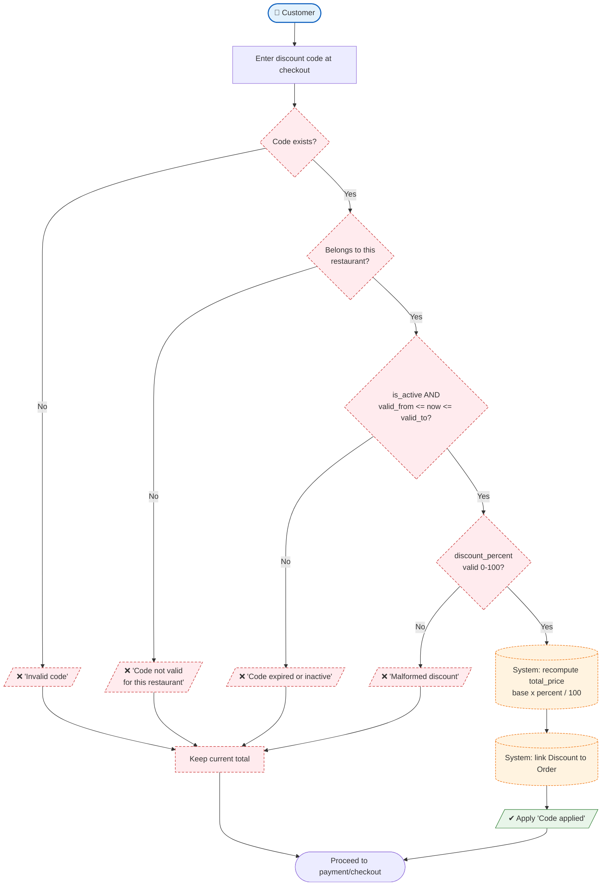

# Process 3 — Apply a Discount Code at Checkout

## Purpose
Lets a **Customer** redeem a restaurant's discount code. The **System**
validates the code against activity, the time window, and the restaurant, then
recalculates the order total — or rejects the attempt with a clear reason.

## Roles involved
- **Customer** — enters a discount code at checkout.
- **System** — validates using `ActiveDiscountManager.get_valid_discounts()`
  and recalculates the total.

## Main steps
1. Customer enters a code at checkout.
2. System looks up the code and checks:
   - does it exist?
   - does it belong to the order's restaurant?
   - is it active and within `valid_from`–`valid_to`?
   - is `discount_percent` between 0 and 100?
3. If valid → apply the percentage, recompute `total_price`, attach the
   `Discount` to the `Order`.
4. If invalid → keep the previous total and show the specific reason.

## Diagram

## Decision points & alternative paths
- **Code exists?** — unknown codes are rejected immediately.
- **Belongs to this restaurant?** — a restaurant's code cannot be used
  elsewhere.
- **Active + within window?** — this mirrors
  `ActiveDiscountManager.get_valid_discounts()`, so a code that is disabled or
  expired is refused.
- **discount_percent valid?** — guards against malformed data.

Every failure branch returns the customer to checkout with the *unmodified*
total, so an invalid code never corrupts the order price.
