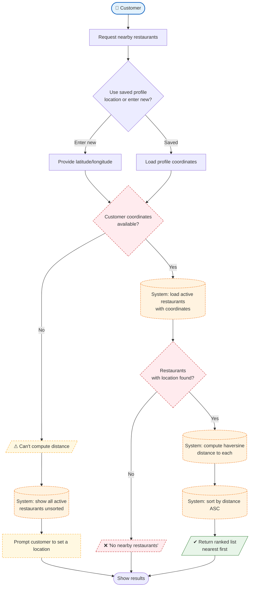

# Process 5 — Discover Nearby Restaurants (Distance-Based)

## Purpose
The distance-based bonus feature: a **Customer** shares their location and the
**System** ranks active restaurants by their great-circle distance (Haversine),
so the closest restaurants appear first. Handles the case where coordinates are
missing.

## Roles involved
- **Customer** — provides a location (or uses their saved profile location).
- **System** — computes distances with `core.utils.haversine_distance()`,
  filters active restaurants, and sorts the result.

## Main steps
1. Customer requests nearby restaurants (manual location or saved profile).
2. System checks that usable coordinates are available.
3. System loads only **active** restaurants that have coordinates
   (`ActiveRestaurantManager`).
4. System computes the distance from the customer to each restaurant.
5. System sorts by ascending distance and returns the list.
6. If no coordinates are available, the system falls back to an unfiltered list
   and prompts the customer to set a location.

## Diagram

## Decision points & alternative paths
- **Customer coordinates available?** — if not, distance cannot be computed; the
  system degrades gracefully to an unfiltered active list and prompts for a
  location. `haversine_distance()` returns `None` when any coordinate is
  missing, which drives this branch.
- **Any restaurants with coordinates?** — if none, a clear “no nearby
  restaurants” message is shown.

## Notes
- Distances are computed in application code (`core.utils.haversine_distance`)
  rather than the database, keeping Phase 1 free of a PostGIS dependency while
  still supporting correct, city-scale ranking.
