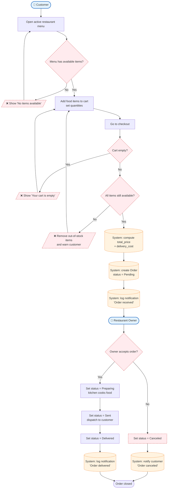

# Process 1 — Place an Order

## Purpose
The core transaction of the platform: a **Customer** builds a cart from a
restaurant's available menu, checks out, and the **System** creates an `Order`
that the **Restaurant Owner** then processes through its lifecycle until it is
delivered (or canceled).

## Roles involved
- **Customer** — browses the menu, manages the cart, confirms the order.
- **Restaurant Owner** — accepts, prepares, dispatches and completes the order.
- **System** — validates availability, creates the order, calculates totals,
  notifies, and enforces the status transitions.

## Main steps
1. Customer opens an active restaurant's menu (only `is_active` restaurants and
   `is_available` food items are visible — enforced by the custom managers).
2. Customer adds items to the cart and sets quantities.
3. Customer proceeds to checkout.
4. System checks the cart is not empty and every item is still available.
5. System computes `total_price` + `delivery_cost` and creates the `Order`
   (status **Pending**).
6. Restaurant Owner sees the new order and accepts it (**Pending → Preparing**).
7. Order is dispatched (**Preparing → Sent**) and delivered
   (**Sent → Delivered**).
8. System writes a `NotificationLog` entry at key state changes.

## Diagram

## Decision points & alternative paths
- **Menu has available items?** — empty menu loops back.
- **Cart empty?** — blocks checkout.
- **All items still available?** — out-of-stock items are removed and the
  customer is warned (prevents ordering unavailable food).
- **Owner accepts order?** — rejection path cancels the order and notifies the
  customer.

## Notation
- `👤` rounded nodes = human **roles**.
- `[ ]` rectangles = **user activities**.
- `[( )]` dashed-orange nodes = **automatic system responses**.
- `{ }` diamonds = **decision points**.
- `/❌ .../` red dashed nodes = **error / rejection paths**.
