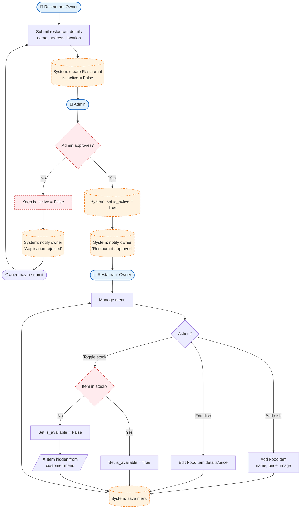

# Process 2 — Restaurant Onboarding & Menu Management

## Purpose
Describes how a **Restaurant Owner** registers their restaurant, waits for
**Admin** approval (activation), and then keeps the menu and stock up to date.
Only approved (`is_active=True`) restaurants become visible to customers.

## Roles involved
- **Restaurant Owner** — submits the restaurant and manages its menu.
- **Admin** — reviews and approves / rejects the restaurant.
- **System** — stores the restaurant, enforces the `is_active` flag, hides
  unavailable items.

## Main steps
1. Owner submits restaurant data (name, address, location).
2. System creates the `Restaurant` with `is_active = False` (awaiting review).
3. Admin reviews the application.
4. If rejected → the restaurant stays inactive and the owner is notified.
5. If approved → `is_active = True`; customers can now see it.
6. Owner adds / edits `FoodItem`s and toggles their availability
   (`is_available`), which controls whether they appear on the public menu.

## Diagram

## Decision points & alternative paths
- **Admin approves?** — rejection keeps the restaurant hidden and notifies the
  owner; they can resubmit.
- **Item in stock?** — setting `is_available = False` hides the item from the
  customer menu (relies on `AvailableFoodManager`).

## Notes
- The `is_active` flag on `Restaurant` is the single source of truth for
  visibility; `ActiveRestaurantManager` guarantees customers never see a
  non-approved restaurant.
