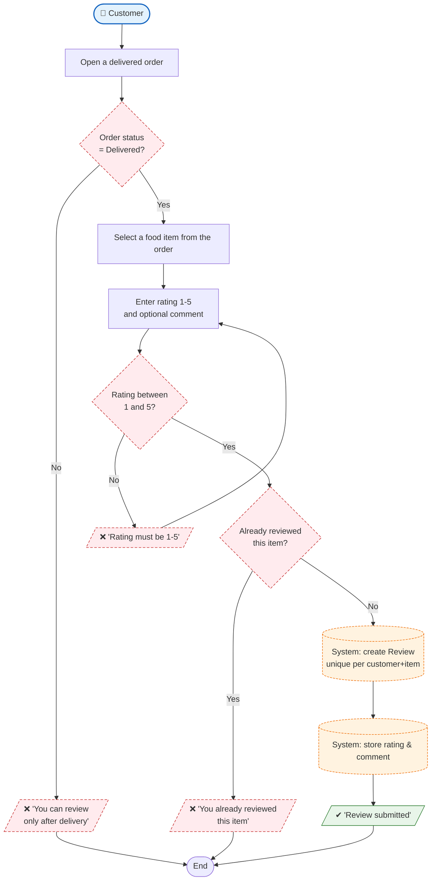

# Process 4 — Submit a Review After Delivery

## Purpose
A **Customer** rates (1–5) and optionally comments on a food item once their
order has actually been delivered. The **System** enforces that only delivered
orders are eligible and that each customer reviews a given food item only once.

## Roles involved
- **Customer** — selects a food item from a delivered order, gives a rating and
  comment.
- **System** — verifies eligibility, validates the rating range, enforces the
  uniqueness constraint, and stores the `Review`.

## Main steps
1. Customer opens a delivered order and picks a food item to review.
2. System confirms the item belongs to a **Delivered** order of this customer.
3. Customer supplies a rating (1–5) and optional comment.
4. System validates the rating is within 1–5.
5. System checks the customer has not already reviewed this item.
6. System saves the `Review`.

## Diagram

## Decision points & alternative paths
- **Order status = Delivered?** — reviews are only allowed on completed orders
  (prevents rating food the customer never received).
- **Rating 1–5?** — validated by `MinValueValidator` / `MaxValueValidator`;
  invalid input loops back for correction.
- **Already reviewed this item?** — `unique_review_per_customer_food_item`
  constraint blocks duplicates.

## Notes
- The uniqueness rule is enforced both in the app flow and at the database level
  via `Meta.constraints`, so the guarantee holds even under concurrent requests.
